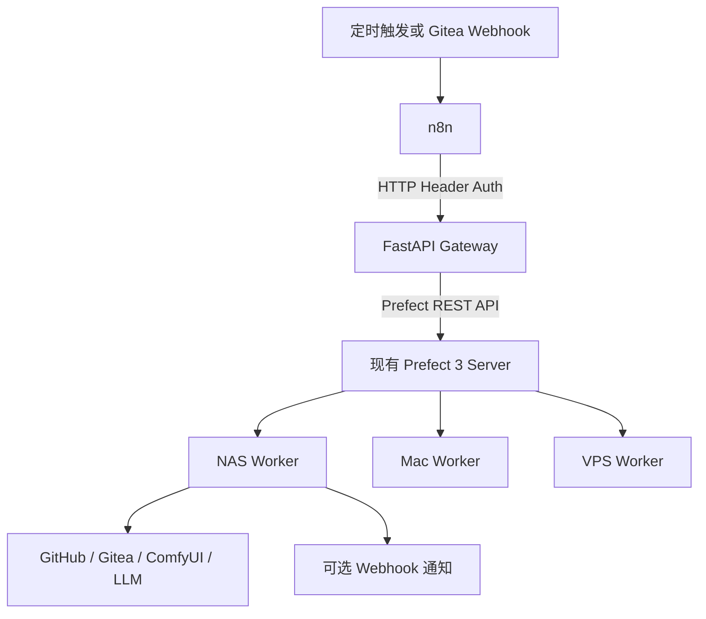

# AI Automation Hub

一个可自托管的 AI 自动化中枢：**n8n（触发）→ 受控 API Gateway（鉴权/任务白名单）→ Prefect 3（调度）→ NAS/Mac/VPS Worker（执行）→ MCP/LLM/外部服务（工具）**。

**状态：v0.1 MVP**。已实现调度入口、4 个示例 Flow、n8n 工作流和测试；**并非已经部署到你的 NAS，也不承诺任何真实外部服务已经连通**。

## 架构



**部署思路**：默认只部署 n8n + 独立 PostgreSQL + Gateway；Prefect 3 Server 复用现有实例。NAS Worker 是可选的 Docker Compose profile，Mac/VPS Worker 可在对应机器独立运行。n8n 的 PostgreSQL 不会覆盖已有 Prefect/其他服务数据库。

## 项目功能

| 任务名 | Flow | 行为 | 外部依赖 |
|---|---|---|---|
| `nas-health` | `nas-health/nas-default` | 检测挂载磁盘、受信任 HTTP 地址、可选 Docker 容器状态，异常时告警 | 可选 |
| `github-digest` | `github-digest/nas-default` | 查询 GitHub **最近更新的仓库**、生成摘要、可选推送 | GitHub REST |
| `gitea-status` | `gitea-status/nas-default` | 查询 Gitea SHA 的 CI Commit Status，失败时告警 | Gitea API |
| `comfyui-submit` | `comfyui-submit/nas-default` | 根据本地白名单 JSON 模板向 ComfyUI 排队 | ComfyUI API |

AI 摘要只有配置 `LLM_BASE_URL` 和 `LLM_MODEL` 才会开启；否则返回确定性文本。默认不会将代码或日志发送给第三方 AI 服务。

## 快速启动基础服务

前提：Docker Engine + Compose v2，现有 Prefect 3 Server 已可以从 Docker 网络访问。

```bash
cp .env.example .env
python -c 'import secrets;print(secrets.token_urlsafe(48))'
# 把生成的随机值填入 .env 中的 GATEWAY_API_KEY 等三个独立的密钥字段
# 把 PREFECT_API_URL 改成容器能访问的实际地址，例如 http://192.168.1.10:4200/api
chmod 600 .env

docker compose up -d --build n8n gateway
# http://localhost:5678 仅当前 NAS 本机的回环地址可用
# http://localhost:8099/healthz 验证 Gateway
```

### 注册 Prefect 部署 + 启动 NAS Worker

```bash
# 只在 Prefect 里新建名为 nas-local 的 process work pool（若已存在则跳过）
docker compose --profile worker run --rm worker prefect work-pool create nas-local --type process
# 必须与代码同步：注册四个部署（默认全部由 nas-local 处理）
docker compose --profile worker run --rm worker prefect deploy --all
# 启动可执行本项目代码的 Worker
docker compose --profile worker up -d --build worker
```

注意：本示例使用无远程代码拉取的 `pull: []`。每台 Worker 必须有相同版本项目代码，且启动进程所在工作目录能解析 `src/`；Docker Worker 的工作目录固定为 `/app`。Mac/VPS 上要自行 clone 代码并安装 `pip install -e '.[worker]'`，再配置 `PREFECT_API_URL` 和 `prefect worker start --pool <pool> --type process`。要让某个 Flow 跑到 Mac/VPS，需要在 `prefect.yaml` 中给该 Flow 配置对应工作池并重新部署。

### n8n 导入

1. 在 n8n UI 导入 `n8n/workflows/github-digest.json`。
2. 在 n8n Credentials 中新建 **Header Auth**：Name `X-Automation-Key`，Value 为 `.env` 中的 `GATEWAY_API_KEY`。不要将密钥写入工作流 JSON。
3. 把该 Credential 分配给工作流的 HTTP Request 节点，先手动执行成功，再激活调度。
4. `gitea-status-webhook.json` 仅供**可信内网**参考；未验证 webhook 签名，**不得将此入口直接暴露公网**。应先在网关或 n8n 前置层增加 Gitea 签名/HMAC 验证。

### 手动调用

```bash
export GATEWAY_API_KEY='<.env里的值>'
./scripts/smoke-test.sh

curl -X POST http://127.0.0.1:8099/v1/jobs/github-digest \
  -H "X-Automation-Key: $GATEWAY_API_KEY" \
  -H 'Content-Type: application/json' \
  -d '{"parameters":{"query":"topic:comfyui","max_items":5},"idempotency_key":"demo-2026-11-19"}'
```

响应 `202` 表示 Prefect 已受理任务，**不代表执行成功**。从 Prefect UI 查看任务是否真正完成。

## 安全原则

- Gateway 只允许四种任务、限定参数结构，不能运行任意脚本或访问任意 URL。
- Prefect REST API 不要直接暴露在公网；使用内网、Tailscale 或反向代理鉴权。
- Compose 中 n8n/Gateway 只绑定 NAS 的 `127.0.0.1`。跨设备访问需要经过明确配置的 HTTPS/Tailscale 反代。
- 工作流示例不包含任何凭据；`.env` 已被 `.gitignore` 排除。
- 不默认挂载 Docker socket：挂载 `/var/run/docker.sock` 对宿主机拥有接近 root 权限，不要以 `:ro` 误认为安全。
- 外部 API 返回、仓库描述和 AI 输出全部视为非可信数据，不自动执行其指令。
- ComfyUI 使用 `workflows/` 本地批准的模板；示例模板必须改成实际存在的 checkpoint 才能用。
- 本项目不自动更改 Gitea 代码、不自动更新生产容器、不自动公开发帖。

## 文件结构

```text
compose.yaml                 n8n + PostgreSQL + Gateway + optional Worker
prefect.yaml                 4 个 Flow 的 Prefect 3 部署声明
src/automation_hub/gateway.py API Key + 白名单 + Prefect REST 调度
src/automation_hub/flows/  NAS/GitHub/Gitea/ComfyUI Flow
src/automation_hub/services/ 可选本地 LLM 与通知 Webhook
n8n/workflows/              可导入的 n8n JSON
workflows/                  ComfyUI 白名单 API 工作流模板
scripts/                    冒烟测试脚本
tests/                      Gateway 单元测试
docs/                       架构与扩展说明
```

完整部署、安全提示、工作池规划参见 [docs/DEPLOY.md](docs/DEPLOY.md) 与 [docs/ARCHITECTURE.md](docs/ARCHITECTURE.md)。

## 本地测试

```bash
python -m pip install '.[gateway,worker,dev]'
python -m pytest -q --cov=automation_hub --cov-report=term-missing --cov-fail-under=90
```

### 部署前只读检查（v0.2 开发分支）

建议在编辑 `.env` 后、启动任何容器前运行：

```bash
python scripts/preflight.py --env-file .env
# 或用于 CI 的无敏感值 JSON 输出
python scripts/preflight.py --env-file .env --json
```

此脚本只做静态校验，不连接外部服务、不读取已有凭据仓库，也不会输出密钥内容。它会拦截示例占位符、明显无效的 Prefect API URL、过短的密钥，并警告容器内 localhost 地址、Docker Socket 以及部分不匹配的可选配置。**检查通过不等于 Prefect、n8n、Gitea 或 ComfyUI 已经连通**。详细的测试范围见 [docs/TESTING.md](docs/TESTING.md)。

## 版本范围

- Python 3.11+
- Prefect 3.x（`<4`）
- n8n 容器默认 2.48.5；工作流 JSON 节点使用兼容格式，正式启用前必须在该版本 UI 中验证导入和凭据绑定

授权：MIT。
